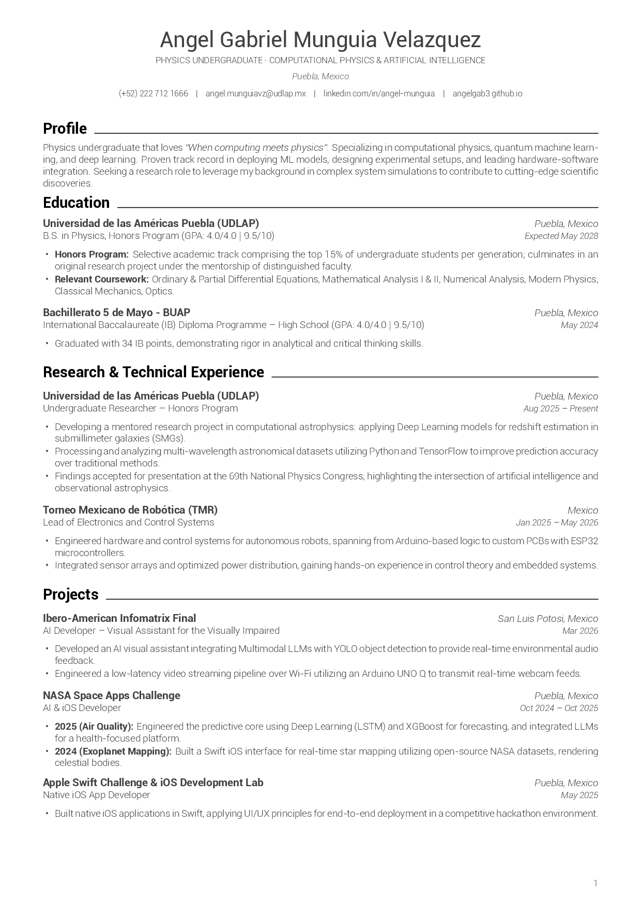
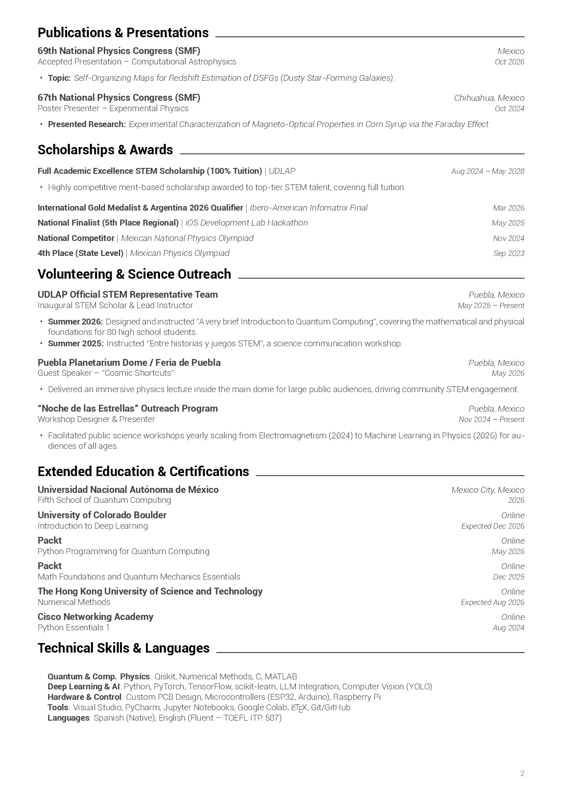

# Curriculum Vitae — Ángel Gabriel Munguía Velázquez

[](https://www.tug.org/xetex/)
[](https://www.overleaf.com/)
[](LICENSE)
[](https://github.com/AngelGab3/CV_code/actions)
[](CV_Gabriel_Velazquez.pdf)

> **Idioma**: **Español** | [English](README_EN.md)

Código fuente en **\LaTeX** del Curriculum Vitae académico y profesional de **Ángel Gabriel Munguía Velázquez**, estudiante de Física en la [Universidad de las Américas Puebla (UDLAP)](https://www.udlap.mx/) e investigador de pregrado en Física Computacional, Aprendizaje Profundo y Astrofísica.

El diseño sigue una estética minimalista, elegante y de escala de grises inspirada en la plantilla de referencia *Nicoinsilico*, optimizada tanto para lectura humana como para pasar filtros automatizados de reclutamiento (**ATS - Applicant Tracking Systems**).

---

## Vista Previa del Documento

<div align="center">
  <table style="border: none; border-collapse: collapse;">
    <tr>
      <td align="center" width="50%">
        <strong>Página 1</strong><br>
        
      </td>
      <td align="center" width="50%">
        <strong>Página 2</strong><br>
        
      </td>
    </tr>
  </table>
</div>

> [!TIP]
> Puedes consultar la versión PDF vectorial de alta calidad directamente abriendo [`CV_Gabriel_Velazquez.pdf`](CV_Gabriel_Velazquez.pdf).

---

## Características de Diseño y Maquetación

- **Motor de compilación XeLaTeX**: Emplea el paquete `fontspec` para cargar tipografías modernas OpenType/TrueType directamente desde la carpeta local `fonts/`.
- **Tipografía Sans-Serif**: Familia tipográfica completa de **Roboto** (Google Fonts) en variantes *Light*, *Regular*, *Medium*, *Bold* e *Italic*.
- **Paleta monocromática refinada**:
  - Texto principal: Gris carbón (`#414141`) para reducir el contraste excesivo del negro puro.
  - Metadatos, fechas y pies de página: Gris intermedio (`#5D5D5D`).
  - Encabezados de sección: Negro puro con línea continua (`\leaders\hrule`).
- **Iconografía vectorial**: Integración completa con [`fontawesome5`](https://ctan.org/pkg/fontawesome5) para teléfono, correo, LinkedIn y GitHub.
- **Control de saltos de página**: Uso de `\Needspace{...}` del paquete `needspace` para evitar encabezados o bloques huérfanos entre páginas.
- **Estructura modular con tablas dinámicas**: Uso de `tabularx` para garantizar que las fechas e instituciones queden perfectamente alineadas al margen derecho sin importar la longitud del título.

---

## Estructura del Repositorio

```text
CV_code/
├── .github/
│   └── workflows/
│       └── compile-latex.yml         # Automatización CI/CD para compilar el PDF en cada commit
├── docs/
│   ├── preview_page_1.png            # Imagen de vista previa de la página 1
│   └── preview_page_2.png            # Imagen de vista previa de la página 2
├── fonts/                            # Tipografías TrueType requeridas por XeLaTeX
│   ├── Roboto-Regular.ttf
│   ├── Roboto-Light.ttf
│   ├── Roboto-LightItalic.ttf
│   ├── Roboto-Medium.ttf
│   ├── Roboto-MediumItalic.ttf
│   ├── Roboto-Bold.ttf
│   ├── Roboto-BoldItalic.ttf
│   ├── Roboto-Thin.ttf
│   └── Roboto-ThinItalic.ttf
├── .gitignore                        # Exclusión de archivos auxiliares (.aux, .log, .out, etc.)
├── CV_Gabriel_Velazquez.tex          # Código fuente principal de LaTeX
├── CV_Gabriel_Velazquez.pdf          # Documento final compilado
├── CV_Gabriel_Velazquez_LaTeX.zip    # Archivo comprimido listo para subir a Overleaf
├── LICENSE                           # Licencia MIT
├── Makefile                          # Script de automatización de compilación local
├── README.md                         # Documentación en español
└── README_EN.md                      # Documentación en inglés
```

---

## Guía de Compilación

### Opción 1: Overleaf (Recomendado — En la nube, sin instalación)

1. Descarga el archivo [`CV_Gabriel_Velazquez_LaTeX.zip`](CV_Gabriel_Velazquez_LaTeX.zip) de este repositorio (o clona el repo y comprime `CV_Gabriel_Velazquez.tex` junto con la carpeta `fonts/`).
2. Entra a [Overleaf](https://www.overleaf.com/) e inicia sesión.
3. Haz clic en **New Project** > **Upload Project** y selecciona el archivo `.zip`.
4. En el panel izquierdo superior de Overleaf, abre el menú **Menu**.
5. En la sección **Settings**:
   - **Compiler**: Cambia a **`XeLaTeX`** *(imprescindible para que `fontspec` cargue las fuentes TTF)*.
   - **Main document**: Selecciona `CV_Gabriel_Velazquez.tex`.
6. Haz clic en el botón verde **Recompile**.

---

### Opción 2: Compilación Local (macOS / Linux / Windows)

Asegúrate de contar con una distribución de TeX moderna (por ejemplo: **MacTeX** en macOS, **TeX Live** en Linux, o **MikTeX** en Windows).

1. Clona el repositorio:
   ```bash
   git clone https://github.com/AngelGab3/CV_code.git
   cd CV_code
   ```

2. Compila el documento utilizando **XeLaTeX**:
   ```bash
   xelatex -interaction=nonstopmode CV_Gabriel_Velazquez.tex
   ```

3. *(Opcional)* Si utilizas la herramienta automatizada `latexmk`:
   ```bash
   latexmk -xelatex CV_Gabriel_Velazquez.tex
   ```

4. Para limpiar los archivos temporales generados por la compilación:
   ```bash
   # En Linux / macOS:
   rm -f *.aux *.log *.out *.fls *.fdb_latexmk *.synctex.gz
   ```

---

### Opción 3: Compilación Continua con GitHub Actions (CI/CD)

El repositorio incluye un flujo de trabajo preconfigurado en `.github/workflows/compile-latex.yml`. 

Cada vez que realizas un `git push` a la rama `main` con cambios en el archivo `.tex` o en las fuentes, GitHub Actions compilará el documento automáticamente en la nube utilizando contenedores con XeLaTeX y almacenará el PDF generado como un artefacto descargable en la pestaña **Actions**.

---

## Guía de Personalización y Comandos

El archivo `CV_Gabriel_Velazquez.tex` incluye un conjunto de macros modulares diseñadas para mantener la consistencia del espaciado y facilitar la adición de nuevos elementos:

### 1. Encabezado de Sección (`\cvsection` o `\section`)
Inserta un título con protección de salto de página y una línea horizontal hasta el borde derecho:
```latex
\section{Educación}
```

### 2. Entradas Principales con Dos Filas (`\resumeSubheading`)
Ideal para instituciones educativas, empresas o puestos de investigación:
```latex
\resumeSubHeadingListStart
  \resumeSubheading
    {Nombre de la Institución / Empresa}{Ciudad, País}
    {Título / Rol / Grado}{Periodo (Ej. Ago 2025 -- Presente)}
    \resumeItemListStart
      \resumeItem{Descripción concisa del logro o responsabilidad.}
      \resumeItem{Uso de \textbf{tecnologías} o metodologías aplicadas.}
    \resumeItemListEnd
\resumeSubHeadingListEnd
```

### 3. Entradas de Proyectos o Líneas Compactas (`\resumeProjectHeading`)
Para proyectos destacados o participaciones breves:
```latex
\resumeProjectHeading
  {\textbf{Nombre del Proyecto} $|$ \emph{Tecnologías utilizadas}}{Fecha}
```

### 4. Ajuste de Márgenes y Colores
Al principio de `CV_Gabriel_Velazquez.tex` puedes personalizar la configuración estética:
```latex
% Márgenes del documento (geometría)
\usepackage[margin=1.4cm,top=1cm,bottom=1.4cm,footskip=.65cm]{geometry}

% Definición de colores
\definecolor{darktext}{HTML}{414141}  % Color del cuerpo del texto
\definecolor{graytext}{HTML}{5D5D5D}  % Color de fechas y subtítulos
```

---

## Paquetes de LaTeX Utilizados

| Paquete | Propósito |
| :--- | :--- |
| [`fontspec`](https://ctan.org/pkg/fontspec) | Carga y gestión de fuentes TrueType/OpenType en XeLaTeX. |
| [`geometry`](https://ctan.org/pkg/geometry) | Configuración de márgenes, encabezados y pies de página. |
| [`xcolor`](https://ctan.org/pkg/xcolor) | Definición de colores personalizados en formato HTML HEX. |
| [`tabularx`](https://ctan.org/pkg/tabularx) | Tablas con columnas autoajustables `X` para alineación limpia izquierda-derecha. |
| [`titlesec`](https://ctan.org/pkg/titlesec) | Formateo avanzado de títulos y secciones. |
| [`fancyhdr`](https://ctan.org/pkg/fancyhdr) | Personalización de encabezados y numeración de página. |
| [`needspace`](https://ctan.org/pkg/needspace) | Evita saltos de página inapropiados antes de secciones o subsecciones. |
| [`fontawesome5`](https://ctan.org/pkg/fontawesome5) | Íconos vectoriales modernos (GitHub, LinkedIn, Email, Teléfono). |
| [`hyperref`](https://ctan.org/pkg/hyperref) | Enlaces interactivos sin recuadros de color (`[hidelinks]`). |
| [`enumitem`](https://ctan.org/pkg/enumitem) | Control preciso del espaciado entre viñetas (`parsep`, `itemsep`). |

---

## Autor y Contacto

**Ángel Gabriel Munguía Velázquez**
- *Physics Undergraduate — Computational Physics & AI* en UDLAP (Puebla, México)
- **LinkedIn**: [Ángel Gabriel Munguía Velázquez](https://www.linkedin.com/in/%C3%A1ngel-gabriel-mungu%C3%ADa-vel%C3%A1zquez-53806930a)
- **GitHub**: [@AngelGab3](https://github.com/AngelGab3)
- **Email institucional**: [angel.munguiavz@udlap.mx](mailto:angel.munguiavz@udlap.mx)

---

## Licencia

Este repositorio se distribuye bajo la licencia **MIT**. Eres libre de tomar esta plantilla y adaptarla para tu propio Curriculum Vitae. Las fuentes tipográficas Roboto pertenecen a [Google Fonts](https://fonts.google.com/specimen/Roboto) bajo la Licencia Apache 2.0.
