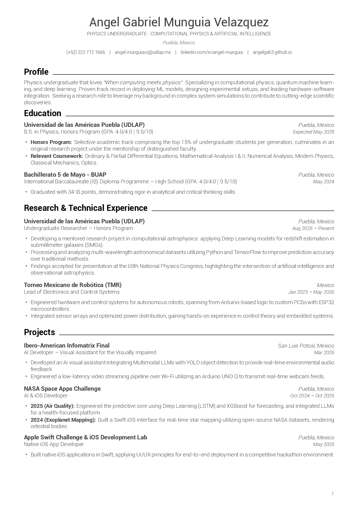
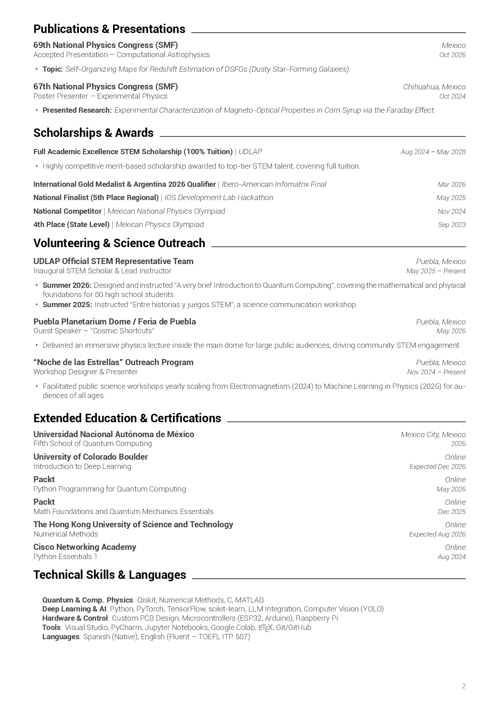

# 📄 Curriculum Vitae — Ángel Gabriel Munguía Velázquez

[](https://www.tug.org/xetex/)
[](https://www.overleaf.com/)
[](LICENSE)
[](https://github.com/AngelGab3/CV_code/actions)
[](CV_Gabriel_Velazquez.pdf)

> **Language**: [Español](README.md) | **English**

**\LaTeX** source code for the academic and professional Curriculum Vitae of **Ángel Gabriel Munguía Velázquez**, Physics undergraduate at [Universidad de las Américas Puebla (UDLAP)](https://www.udlap.mx/) and researcher in Computational Astrophysics, Deep Learning, and Quantum Computing.

The design follows a minimalist, elegant grayscale aesthetic inspired by the *Nicoinsilico* reference format, optimized both for human reading and automated screening systems (**ATS - Applicant Tracking Systems**).

---

## 👁️ Document Preview

<div align="center">
  <table style="border: none; border-collapse: collapse;">
    <tr>
      <td align="center" width="50%">
        <strong>Page 1</strong><br>
        
      </td>
      <td align="center" width="50%">
        <strong>Page 2</strong><br>
        
      </td>
    </tr>
  </table>
</div>

> [!TIP]
> You can download and inspect the full high-resolution PDF directly at [`CV_Gabriel_Velazquez.pdf`](CV_Gabriel_Velazquez.pdf).

---

## ✨ Features and Layout

- **XeLaTeX compilation engine**: Uses `fontspec` to load modern TrueType/OpenType fonts directly from the local `fonts/` folder.
- **Sans-Serif typography**: Full **Roboto** family (Google Fonts) in *Light*, *Regular*, *Medium*, *Bold*, and *Italic* weights.
- **Refined grayscale palette**:
  - Primary body text: Charcoal (`#414141`) to avoid pure black harshness.
  - Metadata, dates, and page footer: Subtle gray (`#5D5D5D`).
  - Section headings: Pitch black with continuous horizontal rule (`\leaders\hrule`).
- **Vector iconography**: High-resolution icons via [`fontawesome5`](https://ctan.org/pkg/fontawesome5) for phone, email, LinkedIn, and GitHub.
- **Page-break protection**: Powered by `\Needspace{...}` from the `needspace` package to avoid orphaned headings.
- **Modular layout with elastic tables**: `tabularx` guarantees dates and locations are right-aligned regardless of title length.

---

## 📁 Repository Structure

```text
CV_code/
├── .github/
│   └── workflows/
│       └── compile-latex.yml         # CI/CD automation to compile PDF on each push
├── docs/
│   ├── preview_page_1.png            # Preview image for Page 1
│   └── preview_page_2.png            # Preview image for Page 2
├── fonts/                            # TrueType fonts required by XeLaTeX
│   ├── Roboto-Regular.ttf
│   ├── Roboto-Light.ttf
│   ├── Roboto-LightItalic.ttf
│   ├── Roboto-Medium.ttf
│   ├── Roboto-MediumItalic.ttf
│   ├── Roboto-Bold.ttf
│   ├── Roboto-BoldItalic.ttf
│   ├── Roboto-Thin.ttf
│   └── Roboto-ThinItalic.ttf
├── .gitignore                        # Ignore rules for LaTeX build artifacts (.aux, .log, .out, etc.)
├── CV_Gabriel_Velazquez.tex          # Main LaTeX source document
├── CV_Gabriel_Velazquez.pdf          # Compiled output document
├── CV_Gabriel_Velazquez_LaTeX.zip    # Standalone archive ready for 1-click Overleaf upload
├── README.md                         # Documentation in Spanish
└── README_EN.md                      # Documentation in English
```

---

## 🚀 How to Compile

### Option 1: Overleaf (Recommended — Zero-install Cloud Setup)

1. Download [`CV_Gabriel_Velazquez_LaTeX.zip`](CV_Gabriel_Velazquez_LaTeX.zip) from this repository.
2. Log into [Overleaf](https://www.overleaf.com/).
3. Click **New Project** > **Upload Project** and select the `.zip` file.
4. In the upper-left menu (**Menu**), configure:
   - **Compiler**: **`XeLaTeX`** *(required for `fontspec` and local TTF fonts)*.
   - **Main document**: `CV_Gabriel_Velazquez.tex`.
5. Click **Recompile**.

---

### Option 2: Local Compilation (macOS / Linux / Windows)

Make sure you have a standard TeX distribution installed (**MacTeX** on macOS, **TeX Live** on Linux, or **MikTeX** on Windows).

1. Clone the repository:
   ```bash
   git clone https://github.com/AngelGab3/CV_code.git
   cd CV_code
   ```

2. Compile using **XeLaTeX**:
   ```bash
   xelatex -interaction=nonstopmode CV_Gabriel_Velazquez.tex
   ```

3. *(Optional)* Alternatively, compile with `latexmk`:
   ```bash
   latexmk -xelatex CV_Gabriel_Velazquez.tex
   ```

4. Clean auxiliary temporary files:
   ```bash
   # On macOS / Linux:
   rm -f *.aux *.log *.out *.fls *.fdb_latexmk *.synctex.gz
   ```

---

### Option 3: Continuous Integration with GitHub Actions (CI/CD)

The repository comes with a workflow file at `.github/workflows/compile-latex.yml`.

Whenever you push commits to `main` modifying the `.tex` file or the `fonts/` directory, GitHub Actions automatically compiles the PDF in an isolated Ubuntu container and provides the resulting PDF as a build artifact in the **Actions** tab.

---

## 🛠️ Customization Guide

The file `CV_Gabriel_Velazquez.tex` provides clean, reusable macros:

### 1. Section Header (`\section` / `\cvsection`)
```latex
\section{Education}
```

### 2. Dual-Column Experience Entry (`\resumeSubheading`)
```latex
\resumeSubHeadingListStart
  \resumeSubheading
    {Organization / University}{City, Country}
    {Position / Degree}{Timeframe (e.g. Aug 2025 -- Present)}
    \resumeItemListStart
      \resumeItem{Description of work or achievements.}
      \resumeItem{Key technologies or methodologies used.}
    \resumeItemListEnd
\resumeSubHeadingListEnd
```

### 3. Compact Project Heading (`\resumeProjectHeading`)
```latex
\resumeProjectHeading
  {\textbf{Project Name} $|$ \emph{Tech stack}}{Date}
```

---

## 📦 LaTeX Package Dependencies

| Package | Purpose |
| :--- | :--- |
| [`fontspec`](https://ctan.org/pkg/fontspec) | Loads TrueType fonts directly under XeLaTeX. |
| [`geometry`](https://ctan.org/pkg/geometry) | Configures document dimensions and margins. |
| [`xcolor`](https://ctan.org/pkg/xcolor) | Defines hex color palettes. |
| [`tabularx`](https://ctan.org/pkg/tabularx) | Auto-expanding table columns for perfect right alignment. |
| [`titlesec`](https://ctan.org/pkg/titlesec) | Customizes section headings and rules. |
| [`fancyhdr`](https://ctan.org/pkg/fancyhdr) | Controls headers and footer page numbering. |
| [`needspace`](https://ctan.org/pkg/needspace) | Prevents awkward page breaks before section blocks. |
| [`fontawesome5`](https://ctan.org/pkg/fontawesome5) | Vector glyphs for contact links. |
| [`hyperref`](https://ctan.org/pkg/hyperref) | Clickable hyperlinked URLs. |
| [`enumitem`](https://ctan.org/pkg/enumitem) | Controls bullet point lists and padding. |

---

## 👤 Author & Contact

**Ángel Gabriel Munguía Velázquez**
- 🎓 *Physics Undergraduate — Computational Physics & AI* at UDLAP (Puebla, Mexico)
- 💼 **LinkedIn**: [Ángel Gabriel Munguía Velázquez](https://www.linkedin.com/in/%C3%A1ngel-gabriel-mungu%C3%ADa-vel%C3%A1zquez-53806930a)
- 🐙 **GitHub**: [@AngelGab3](https://github.com/AngelGab3)
- ✉️ **Institutional Email**: [angel.munguiavz@udlap.mx](mailto:angel.munguiavz@udlap.mx)

---

## 📄 License

This repository is distributed under the **MIT** License. You are free to fork, adapt, and use this template for your own CV/resume. Roboto fonts are by [Google Fonts](https://fonts.google.com/specimen/Roboto) under the Apache 2.0 License.
